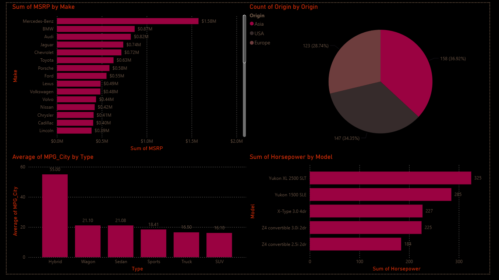
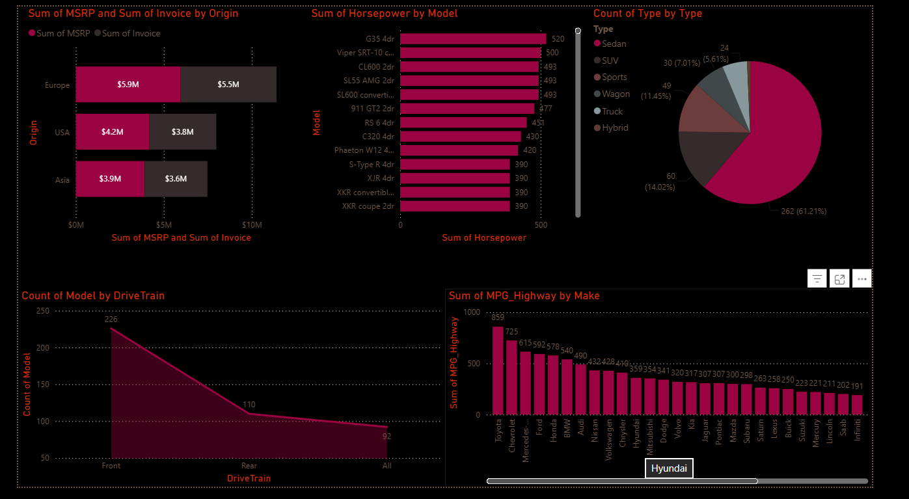
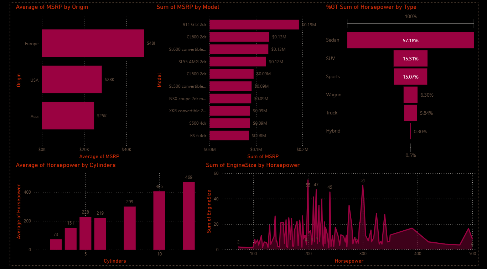

# Cars Data Analysis & Business Intelligence Dashboard

## Project Overview

This project focuses on analyzing automobile data using Microsoft Power BI. The main objective is to explore different aspects of the automobile market, including car manufacturers, vehicle prices, engine specifications, fuel efficiency, drivetrain configurations, and vehicle categories.

The dashboard presents the available data through interactive visualizations, making it easier to compare automobile manufacturers, understand pricing differences, and examine vehicle performance characteristics.

The report is divided into three analytical pages, each focusing on a different area of automobile data.

## Project Objectives

- Analyze automobile manufacturers and their vehicle pricing.
- Compare car models based on horsepower and engine specifications.
- Examine city and highway fuel efficiency.
- Understand the distribution of vehicles across different origins and categories.
- Compare MSRP and invoice prices.
- Explore relationships between engine specifications and vehicle performance.
- Present the analysis through clear and interactive Power BI visualizations.

## Tools & Technologies

- **Microsoft Power BI Desktop:** Dashboard development and data visualization.
- **Power BI Visualizations:** Bar charts, column charts, pie charts, line charts, and funnel charts.
- **Automobile Dataset:** Source data containing vehicle details and technical specifications.

## Dashboard Structure

### 1. Car Market Overview

This page provides an overview of automobile manufacturers, vehicle categories, origins, and horsepower.

Visualizations include:
- Manufacturer-wise MSRP analysis.
- Car type comparison based on city mileage.
- Vehicle distribution by origin.
- Model-wise horsepower comparison.

### 2. Price, Performance & Distribution Analysis

This page explores differences in vehicle pricing, drivetrain configurations, and fuel efficiency.

Visualizations include:
- Comparison of MSRP and invoice by vehicle origin.
- Distribution of car models across drivetrain categories.
- Model-wise horsepower analysis.
- Manufacturer-wise highway mileage comparison.
- Vehicle type distribution.

### 3. Technical Specifications Analysis

This page focuses on the technical characteristics of vehicles.

Visualizations include:
- MSRP comparison by vehicle origin.
- Horsepower comparison across cylinder categories.
- Model-wise MSRP comparison.
- Engine size and horsepower relationship.
- Horsepower distribution across vehicle types.

## Dashboard Screenshots

### 1. Car Market Overview



### 2. Price, Performance & Distribution



### 3. Technical Specifications



## Dataset Information

The report uses a table named `CARS`.

The fields identified in the Power BI report include:

- Make
- Model
- Type
- Origin
- MSRP
- Invoice
- MPG_City
- MPG_Highway
- Horsepower
- DriveTrain
- Cylinders
- EngineSize

These fields support the analysis of vehicle pricing, performance, fuel efficiency, and technical specifications.

## Key Areas of Analysis

1. Automobile manufacturer comparison.
2. Vehicle pricing and invoice analysis.
3. Horsepower and engine specifications.
4. City and highway mileage comparison.
5. Vehicle origin and category distribution.
6. Drivetrain analysis.

## Project Learning Outcomes

Through this project, I gained practical experience in:

- Building a multi-page analytical dashboard in Power BI.
- Selecting suitable visualizations for different analytical requirements.
- Comparing categorical and numerical data.
- Working with aggregations in Power BI.
- Presenting technical automobile information in a visual format.
- Organizing data analysis into separate dashboard sections.

## Repository Structure

```text
Cars-Data-Analysis-PowerBI/
│
├── Dashboard/
├── Screenshots/
├── Dataset/
├── Documentation/
└── README.md
```

## Conclusion

This project demonstrates the use of Power BI for automobile data analysis and business intelligence. It brings together vehicle pricing, manufacturer comparisons, fuel efficiency, and technical specifications in a single multi-page dashboard.

The project represents my practical learning and application of data visualization and analytical reporting using Microsoft Power BI.

---

**Project Category:** Data Analytics / Business Intelligence

**Developed Using:** Microsoft Power BI Desktop
